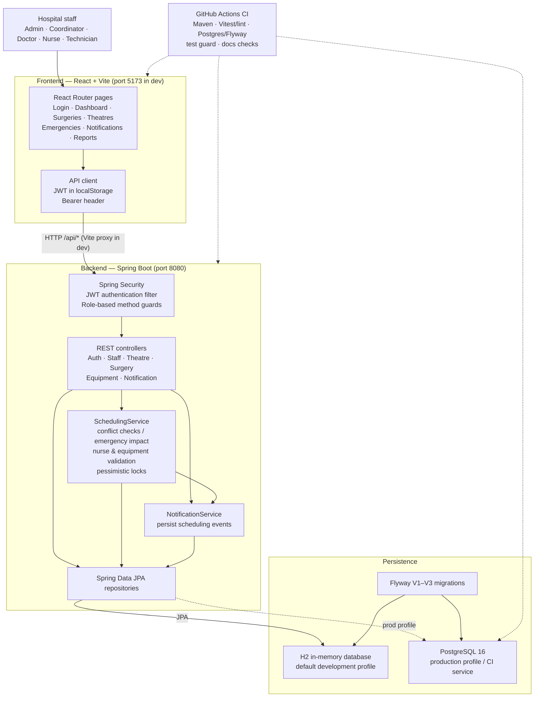
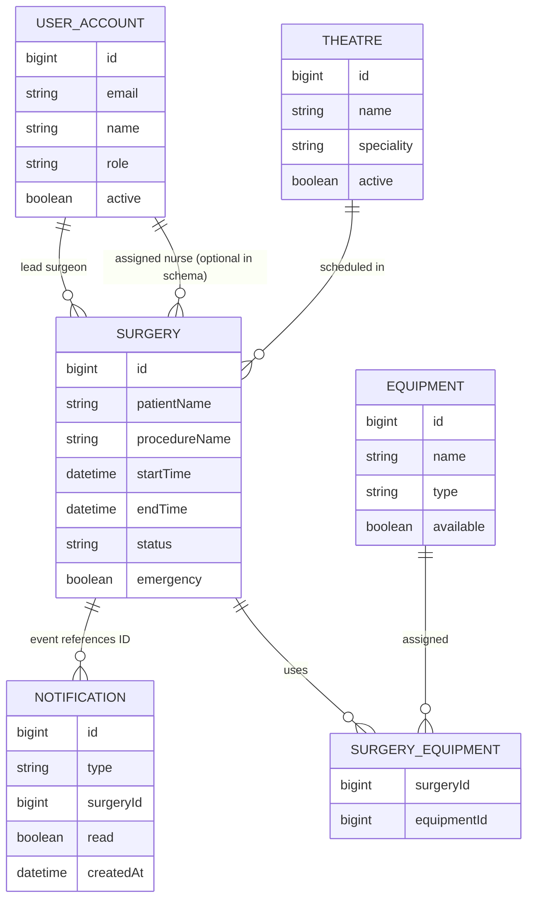
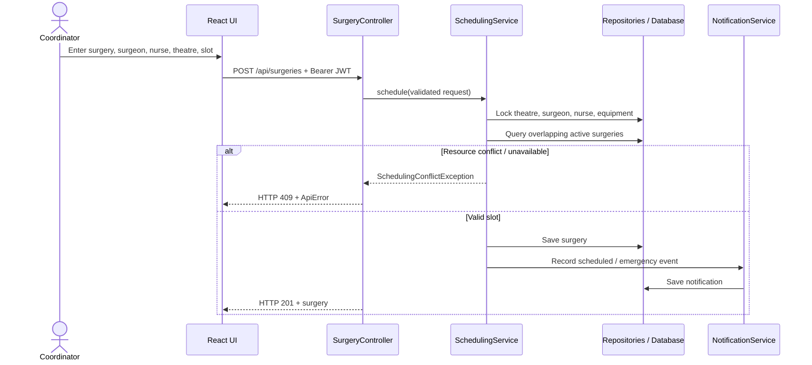

# OTMS — implemented architecture (18 November 2026)

Source of truth: repository `main` at the time of this review. This diagram describes **implemented components**, not aspirational requirements.

## System/component diagram

## Core data model

*Conceptual ER diagram*: notifications store `surgeryId`, not necessarily a database-enforced foreign key. Nurse assignment was introduced in Flyway V3; the column is nullable in the schema, while current scheduling service logic requires an assigned nurse on new surgery requests.

## Example scheduling sequence

## Known boundaries

- **Not in `main`:** full audit-event persistence/query API, refresh tokens, account lockout and rate limiting (corresponding feature PRs were closed without merge). Do not present these as implemented features.
- **Frontend:** React/Vite dev server proxies `/api` to `localhost:8080`; this is not a production deployment diagram.
- **Authentication:** login returns a signed JWT; the frontend holds it in `localStorage`. The server checks the JWT and method-level roles. Self-registration is intentionally unavailable (placeholder responds 501).
- **Availability:** current application checks active theatre/surgeon/nurse and equipment plus overlapping bookings; it does **not** model comprehensive staff rosters, shift hours, or leave calendars.
- **Emergency workflow:** the app provides impact analysis and assisted rescheduling; do not imply that every affected surgery is automatically rescheduled.
- **Reporting:** utilization/CSV/print views are calculated on the frontend from the existing surgery APIs; no dedicated report controller exists in current `main`.
- **CI:** `main` passed the most recent observed CI run, while draft PR #53 failed frontend lint; do not describe the draft additions as merged.

Related files: `frontend/src/App.jsx`, `frontend/src/api/client.js`, `backend/src/main/java/com/otms/controller/`, `backend/src/main/java/com/otms/service/SchedulingService.java`, `backend/src/main/resources/db/migration/`, `.github/workflows/ci-cd.yml`.
